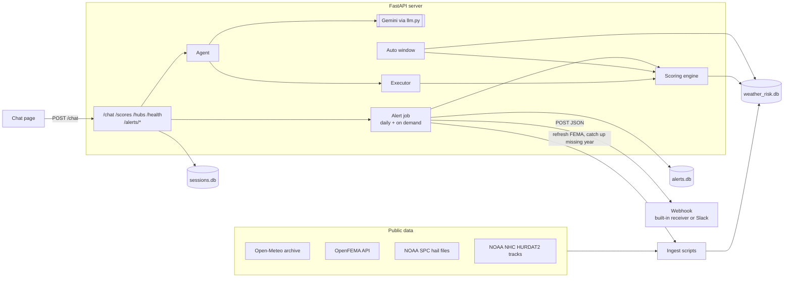

# Design: Weather Risk Intelligence Agent

An agent that helps logistics analysts decide which hubs are most exposed to weather disruption.
**Scores come from deterministic code; the LLM (Gemini) only turns the question into a structured
plan and explains the computed facts.** Scope: 10 hubs × 5 hazards (winter, flood, severe storms,
hurricanes, heat), 2016–2025.

More detail (KPI, hazards, alerts, evaluation, trade-offs): [DESIGN_DETAILS.md](DESIGN_DETAILS.md).
Assumptions and data caveats: [ASSUMPTIONS.md](ASSUMPTIONS.md). Decision log: [PLAN.md](PLAN.md).

## 1. System architecture



| Component | File(s) | What it does and how it talks to the others |
|---|---|---|
| Ingest | `weather_risk/ingest/` | Fetches the 4 sources ahead of time and upserts them into `weather_risk.db`, logging every request in `ingest_runs`. The chat never calls a third-party API. |
| Scoring engine | `scoring.py`, `config/scoring.toml` | Pure functions: stored data + config → score per hub and hazard, with evidence. Overall = noisy-OR of 5 hazards. No LLM. |
| Auto window | `window.py` | Picks the scoring window: the last complete year, **only once every source has that full year**; otherwise it keeps the current window and reports why. |
| Executor | `agent/executor.py` | Runs a validated plan (rank / compare / explain / weather_stat) and returns **facts**: scores, ranks, drivers, ties, premise check. |
| LLM client | `llm.py` | The only Gemini caller. Requests JSON for a Pydantic schema, validates, retries once, else raises. |
| Agent | `agent/agent.py`, `schemas.py`, `prompts.py` | One turn: **plan** (LLM → `QueryPlan` JSON) → **execute** (code → facts) → **narrate** (LLM → `Answer` JSON, facts only). |
| API | `api.py` | FastAPI. `/chat` loads the session history, runs the agent, saves the turn. Demo password on everything except `/health`. Starts the daily alert task. |
| Alerts | `alerts.py` | Refresh data → window → score → snapshot → compare with the last snapshot → one alert per hub (rank change, overall ±2, hazard ±10, FEMA event in/out) → webhook. |
| Chat UI | `static/index.html` | One page. Calls only `/chat`; shows the plan and facts under each answer ("How I got this"). **Voice:** a mic button (browser Web Speech API) makes it a voice conversation: speech → the same `/chat` question, sent when you stop speaking → the short direct answer read aloud (en-US). No backend change. |

**One chat turn:** UI → `POST /chat` → planner (Gemini, `QueryPlan`; hubs and hazards are enums
built from config) → executor computes facts → narrator (Gemini, `Answer`) → API saves the turn → UI.
Numbers in answers come only from the facts; the eval checks this.

**Deployment:** Render free web service from `render.yaml`. Secrets (`GEMINI_API_KEY`,
`DEMO_PASSWORD`) live in the Render dashboard. Render's disk is ephemeral: **anything downloaded
while running** (FEMA refreshes, catch-up weather/hail/HURDAT2, chat and alert state) **is lost on
restart**. The app starts again from the committed `weather_risk.db` and downloads again on the next alert run.

## 2. Repository structure

```
config/        hubs.toml (hub registry), scoring.toml (thresholds, bounds, weights, alert rules)
data/          weather_risk.db (committed data snapshot); sessions.db, alerts.db (git-ignored)
docs/          DESIGN.md, DESIGN_DETAILS.md, PLAN.md (decision + eval log), ASSUMPTIONS.md
evals/         cases.toml (25 cases), run_eval.py, results/
scripts/       verify_gemini.py, explore_fema.py (phase-0 checks)
static/        index.html (chat page)
tests/         unit + validation tests, no LLM (43)
weather_risk/  config.py db.py scoring.py window.py alerts.py llm.py sessions.py api.py
  ingest/      open_meteo.py openfema.py spc_hail.py hurdat2.py report.py
  agent/       schemas.py prompts.py executor.py agent.py metrics.py cli.py
render.yaml    deployment;  README.md  run instructions and data attribution
```

## 3. Data storage

**SQLite**, three files:

| File | Contents | In git? |
|---|---|---|
| `data/weather_risk.db` (~14 MB) | `weather_daily` (hub × day, 5 variables), `fema_declarations` (raw, incl. declaration type and program flags), `hail_reports`, `storm_track_points`, `ingest_runs` (provenance: URL, time, rows, status) | **Yes**: a snapshot, so the demo runs without re-fetching |
| `data/sessions.db` | Chat turns per session (question, plan, answer), for follow-ups | No |
| `data/alerts.db` | Score snapshots (window, config fingerprint, scores) and sent alerts | No |

**Why SQLite:**
- The data is small (~45k weather rows, ~100k hail reports, ~18k track points) and read-mostly.
- It's queried with SQL and needs no server, so it works on Windows and on Render with zero setup.
- Upserts make re-running the ingest safe.
- Chat and alert state are kept out of the committed snapshot.

**Alternatives:** JSON/Parquet files (no queries, awkward for state); Postgres (the production choice
for persistent sessions and alerts, since Render's free disk is ephemeral; not worth the setup here).
