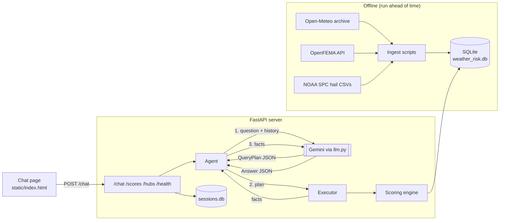

# Design: Weather Risk Intelligence Agent

**Goal:** help logistics analysts decide which distribution hubs are most exposed to weather
disruption and should be prioritized for resilience investment. The agent ranks, compares and
explains hubs in a chat. **All numbers come from deterministic code; the LLM only interprets the
question and explains the computed facts.**

**Scope (narrow on purpose):** 10 hubs (Chicago, Minneapolis, Indianapolis, Kansas City, Columbus,
Dallas, Houston, Miami, Atlanta, Denver) × 5 hazards (winter, flood, severe storms, hurricanes,
extreme heat), scored on 2016–2025. Out of scope: wildfire, earthquake, drought, hub business importance (volume).
Details and every decision with its reason: [PLAN.md](PLAN.md). Assumptions and data caveats:
[ASSUMPTIONS.md](ASSUMPTIONS.md).

---

## 1. System architecture



**Components and how they talk:**

| Component | File(s) | Role |
|---|---|---|
| Ingest | `weather_risk/ingest/*.py` | Fetches public data once and stores it raw in SQLite. Retries, rate-limit pauses, and a provenance log (`ingest_runs`). The demo never depends on a live third-party API. |
| Scoring engine | `weather_risk/scoring.py`, `config/scoring.toml` | Pure functions: stored data + config → a score per hub and hazard, each with its evidence (raw values, bounds, FEMA event titles). No LLM. |
| Executor | `weather_risk/agent/executor.py` | Runs a `QueryPlan` (rank / compare / explain / weather_stat) and returns **facts**: scores, ranks, drivers, premise check, statistics. |
| LLM client | `weather_risk/llm.py` | The only file that talks to Gemini. Requests JSON for a Pydantic schema, validates it, retries once with the error, then raises → the caller falls back safely. |
| Agent | `weather_risk/agent/agent.py`, `prompts.py`, `schemas.py` | One turn = **plan → execute → narrate**. Out-of-scope / clarify replies are written by code (no second LLM call). |
| API | `weather_risk/api.py` | FastAPI. `/chat` loads the session history, runs the agent, saves the turn. `/scores` returns the full deterministic ranking. |
| Chat UI | `static/index.html` | One page, no framework. Calls only `/chat`. A collapsible **"How I got this"** panel under each answer shows the plan and the facts. |

**One chat turn, step by step:**
1. The UI posts `{message, session_id}` to `/chat`. The API loads that session's earlier turns.
2. **Plan (LLM):** Gemini turns the question plus history into a `QueryPlan` JSON. Hub ids, hazards,
   regions and metrics are enums built from config, so it can't name a hub that doesn't exist.
   Follow-ups ("what about Chicago?") are resolved here.
3. **Execute (code):** the executor validates the plan (e.g. compare needs ≥ 2 hubs) and computes the facts.
4. **Narrate (LLM):** Gemini writes an `Answer` JSON (`answer`, `caveats`, `confidence`) from the facts
   only. The prompt requires: use only numbers in the facts, give the rank next to every score,
   check the question's premise, and state the data limits.
5. The API stores the turn and returns the answer + plan + facts to the UI.

**Why plan → execute → narrate (and not a free function-calling loop):** the control flow is fixed
and every step can be shown and tested. The eval can check the expected plan exactly, and the LLM
never produces a number. The trade-off is that unusual multi-step questions must fit the plan schema
(list of hubs + top N covers the example questions).

**LLM:** Google Gemini (`gemini-4-hydrogen`, paid Tier 1, $10 cap). It supports JSON-schema output,
and all four capabilities we use were verified in `scripts/verify_gemini.py`. Switching provider
means rewriting `llm.py` only.

## 2. The KPI: hub weather-disruption score

Deterministic, configured in `config/scoring.toml`:

- **Signal score** = `min(value / bound, 1) × 100`, with **fixed bounds** (absolute, not relative to
  the other hubs). Adding a hub never changes another hub's score, and alerts can't fire because of re-normalization.
- **Hazard score** = weighted sum of components:

| Hazard | Components (weight) | Signals |
|---|---|---|
| Winter | weather 0.7, FEMA 0.3 | snow days ≥ 0.25 cm, heavy snow ≥ 5 cm, min ≤ −18 °C, ice days* |
| Flood | weather 0.7, FEMA 0.3 | rain ≥ 50 mm, rain ≥ 100 mm |
| Severe storm | hail 0.35, gusts 0.35, FEMA 0.3 | hail ≥ 1" and ≥ 2" within 50 km (days), gusts ≥ 80 km/h |
| Hurricane | storm tracks 0.7, FEMA 0.3 | tropical storms/hurricanes passing within 200 km (NOAA HURDAT2, **1991–2025**), FEMA hurricane events |
| Heat | weather 1.0 | days with max ≥ 35 °C (bound 50/yr), ≥ 37.8 °C (bound 16/yr). FEMA doesn't declare heat disasters |

  \*Ice day = precip ≥ 2 mm, max ≤ 1 °C, less than half of it fell as snow (0.7 cm snow per mm, measured in our data).
  FEMA events = distinct incidents with a **Major Disaster declaration with household aid in the hub's
  county** (rule D). This removes precautionary or evacuee-support declarations, e.g. Dallas's Harvey declaration.
- **Overall** = noisy-OR: `100 × (1 − Π(1 − hazard/100))`. Disruption happens if *any* hazard hits,
  so having no hurricanes doesn't offset hail. One hazard at 100 saturates the overall score (Houston).
- **Explanations:** the executor reports each signal's points within its hazard, each hazard's
  leave-one-out contribution to the overall score, and ranks among hubs (ties flagged, zero = no rank).

**Different time window for hurricane tracks:** every signal uses 2016–2025, except storm tracks,
which use **1991–2025 (35 years)**. Hurricanes are rare: in 10 years, counts are 0–3 per hub, too
noisy to rank on. The track window is set in config (`window_start_year`/`window_end_year`) and
stated in the agent's caveats. Mixing windows assumes the 1991–2025 storm climate is representative
of today, which is the same "past ≈ future" assumption as A9, over a longer period.

**Effectively tied:** overall scores less than **1 point** apart are flagged `effectively_tied` by the
executor. The agent then says the hubs are tied and explains how their profiles differ, instead of
naming a single #1. At the saturated top, the gap is noise.

Current result: **Dallas 99.1 and Houston 98.8 (effectively tied for #1)**, Miami 86.4 (#3), Chicago
76.4, Kansas City 75.7, Minneapolis 73.4, Denver 60.8, Columbus 56.2, Indianapolis 53.4, Atlanta 51.2.
They differ completely in profile: Dallas = heat (97.7) + hail; Houston = flood (89.5) + hurricane (74.9).

### Heat as a fifth hazard, and the limits of equal weights

**Why heat is included:** the assignment describes disruption as severe weather that "shuts hubs
down, delays shipments and costs us money". Heat rarely shuts a hub, but it delays shipments and costs
money over many days: crew work-rest limits, equipment and reefer strain, slower yard operations.

**Known limitations:**
- **Equal weights don't capture severity.** Heat reduces capacity over many days, while ice or a
  hurricane can close a hub outright. Under noisy-OR, a heat score of 97.7 counts as much as a hurricane
  score of 97.7. The fix is weights (or a severity factor) from the customer's own downtime and delay
  costs, the first open question for the customer (Q1). The agent states this caveat whenever heat matters.
- **The ranking moves a lot for one hub.** Dallas has by far the most hot days (48.6/yr ≥ 95 °F,
  15.7/yr ≥ 100 °F), so heat alone takes it from **#6 to #2**. No other hub changes position:

| Hub | Overall before heat | Heat score | Overall with heat |
|---|---|---|---|
| Houston | 100.0 (#1) | 38.1 | 100.0 (#1) |
| **Dallas** | **61.8 (#6)** | **97.7** | **99.1 (#2)** |
| Chicago | 76.2 (#2) | 0.9 | 76.4 (#3) |
| Kansas City | 73.6 (#3) | 8.0 | 75.7 (#4) |
| Minneapolis | 73.1 (#4) | 1.0 | 73.4 (#5) |
| Miami | 69.7 (#5) | 0.6 | 69.8 (#6) |
| Denver | 57.8 (#7) | 7.1 | 60.8 (#7) |
| Columbus | 56.2 (#8) | 0.0 | 56.2 (#8) |
| Indianapolis | 53.3 (#9) | 0.1 | 53.4 (#9) |
| Atlanta | 36.5 (#10) | 4.1 | 39.1 (#10) |

- **Saturation near 100 at the top.** Noisy-OR compresses the top. (The table above is before
  HURDAT2; with storm tracks, Houston is 98.8 and Dallas 99.1.) The gap between them says almost
  nothing, so the executor flags gaps under 1 point as effectively tied (above). For the top hubs, the
  per-hazard scores and their drivers carry the information, not the overall number.

### Alerts on the long-term score (bonus)

The alert watches **the same long-term score** the analysts use, not a separate forecast score.
Three things can change it, and the system watches each:

| What changes the score | How it's detected |
|---|---|
| A new FEMA declaration in a hub's county | The daily job re-pulls OpenFEMA (the only source that changes day to day) |
| The yearly window moving forward | **Auto window**: it ends at the last complete calendar year, but moves only once *every* source has that full year (Open-Meteo lags ~2 days; SPC hail and HURDAT2 come out months later). Until then it stays put, and the reason is logged with the snapshot (`weather_risk/window.py`) |
| A config change (thresholds, bounds, weights) | A fingerprint of `scoring.toml` is stored with each snapshot; alerts say "config changed" |

**Each run** (`weather_risk/alerts.py`): refresh FEMA → pick the window → score all hubs → save a
snapshot (`data/alerts.db`) → compare with the previous snapshot → **one alert per hub** listing every
reason → POST JSON to `ALERT_WEBHOOK_URL`. By default that's our own `/alerts/webhook-receiver`,
standing in for Slack, Teams or email.

**Thresholds** (`[alerts]` in config, user-approved after measuring a real one-year window shift):
any overall **rank change** (labelled if the hubs are now effectively tied); **overall change ≥ 2.0**;
any **hazard change ≥ 10**; a **FEMA event that counts entering or leaving** the window. The normal
year-to-year drift is 0.1–1.5 overall and ≤ 4.7 per hazard, so the thresholds sit above it.

**Trigger:** a daily task inside FastAPI (`ALERT_INTERVAL_HOURS`, default 24), plus
`POST /alerts/check` on demand. `GET /alerts` lists past alerts.

**Demo with real data, not fake data** (`POST /alerts/demo`): score the 2015–2024 window as the
baseline, then 2016–2025. Result: **5 alerts, 5 quiet hubs**:
- Dallas and Houston swap #1/#2 (now effectively tied).
- Houston's severe-storm score drops −30.4, because two 2015 FEMA storm/flood disasters leave the window.
- Chicago −2.7 overall.
- Indianapolis −4.9 and drops to #9; Columbus moves up to #8.

A second live check with no new data raised 0 alerts, as expected.

## 3. Data sources

| Source | What | Why | Key caveat |
|---|---|---|---|
| Open-Meteo archive | Daily snow, precip, gusts, min/max temp at each hub's airport point | No key, 10+ years daily | Modeled data: Denver 2025 snow ~1/3 below NWS, so ranks are more reliable than absolute values. Free tier is non-commercial |
| OpenFEMA v2 | Disaster declarations by county | No key; records actual impact | Sparse (0–4 events/hub); depends on politics and damage thresholds |
| NOAA SPC | Hail reports (lat/lon, size) | Hail is a major Dallas risk the other sources miss | Spotter/population bias (we count days, not reports) |
| NOAA NHC HURDAT2 | Atlantic storm tracks, 6-hourly positions and status | Direct hurricane exposure; FEMA alone was 0–2 events per hub | Center track only (no wind-field size); a 200 km radius stands in for the storm's reach |

## 4. Data storage choice

**SQLite**, one file: `data/weather_risk.db` (~13 MB), committed as a snapshot.

- **Why:** the data is small (~40k weather rows, 62 FEMA rows, ~88k hail reports) and read-mostly.
  It's queried with SQL, needs no server (zero setup on Windows or a host), and the committed snapshot
  makes the demo work offline from the data APIs.
- **Tables:**
  - `weather_daily` (hub_id, date, 5 variables; PK hub_id+date)
  - `fema_declarations` (raw, with declaration type and program flags, so counting rules A/B/D are a config switch)
  - `hail_reports` (all US reports; scoring selects by distance)
  - `storm_track_points` (HURDAT2 positions, 1991–2025: 576 storms, 17k points)
  - `ingest_runs` (provenance: URL, time, rows, status; used for attribution)
- **Re-runs:** ingest uses upserts, so re-running is idempotent. NULL is stored as NULL ("no data" ≠ 0).
- **Chat history** lives in a separate `data/sessions.db` (git-ignored), so the data snapshot never
  contains chat logs.
- **Alternatives considered:**
  - JSON/Parquet files: no queries, awkward for sessions and alert state.
  - Postgres: the production choice for multi-user writes, but setup overhead isn't justified here.
    The SQL is plain, so moving is straightforward.

### Deployment

Render free web service from `render.yaml`: build with `pip install -r requirements.txt`, start with
`uvicorn … --host 0.0.0.0 --port $PORT`, health check `/health`.
- **Demo password:** HTTP basic auth on everything except `/health`, enabled by `DEMO_PASSWORD`.
  The URL is public and every chat costs Gemini credits, which already ran out once during development.
  `/health` stays open so the sleeping instance can be woken without a password.
- **Secrets:** `GEMINI_API_KEY` and `DEMO_PASSWORD` are entered in the Render dashboard (`sync: false`), never committed.
- **Free-plan limits, accepted for a demo:**
  - It sleeps after 15 minutes idle (~1 minute to wake).
  - Its filesystem is ephemeral, so `sessions.db` and `alerts.db` reset on restart; the committed `weather_risk.db` is re-deployed each time.
  - The in-process daily alert job only runs while the instance is awake.

  In production: a paid always-on instance or a Render Cron Job calling `POST /alerts/check`, plus Postgres for sessions and alert state.

## 5. Repository structure

```
config/          hubs.toml (hub registry), scoring.toml (every threshold, bound, weight)
data/            weather_risk.db (committed snapshot); sessions.db (git-ignored)
docs/            DESIGN.md (this), PLAN.md (decision log), ASSUMPTIONS.md
evals/           cases.toml (25 cases), run_eval.py, results/
scripts/         verify_gemini.py, explore_fema.py (phase-0 checks and exploration)
static/          index.html (chat page)
tests/           test_scoring.py, test_executor.py, test_validation.py, test_alerts.py (no LLM)
weather_risk/
  config.py db.py scoring.py llm.py sessions.py api.py window.py alerts.py
  ingest/        open_meteo.py openfema.py spc_hail.py hurdat2.py report.py
  agent/         schemas.py prompts.py executor.py agent.py metrics.py cli.py
```

## 6. Evaluation

- **Unit and validation tests (no LLM):** 40 tests. They cover the scoring math, the rule-D counting,
  noisy-OR saturation, executor results on real data (e.g. Denver 2025 = 38/365 = 10.4%), and known
  events. The DFW ice storms of 2022 and 2023 are detected; 2021 is a documented expected failure.
- **Live eval (`evals/`):** 25 cases: the 4 assignment questions, follow-ups, aliases, premise
  checks, out-of-scope questions, the "which hub to invest in" framing, and 3 **holdout** cases written
  after the last prompt change. Each case checks the plan, the facts, required/forbidden phrases, and
  **grounding: every number in the answer must appear in the facts.**
- **Results:** 3 full runs, **68/69 case-runs passed**. 22 of the 23 cases passed 3/3, including 2 of the 3 holdouts.
  The one miss: `holdout_prioritize_pair` ("Between Atlanta and Denver, which one deserves resilience
  upgrades more?") passed 2/3. In one run the planner chose `rank` (restricted to those 2 hubs) instead
  of `compare`. The answer was still correct and grounded (Denver 57.8, #7, vs Atlanta 36.5, #10), so
  only the plan check failed. This is a side effect of the earlier prompt fix ("prioritization
  questions → rank"): the holdout caught the shift, which is what it was for.
  After heat was added (25 cases, 1 run): **24/25**. The same holdout failed the same way, and all
  heat-related cases passed.
- **Limits:** 3 runs is a small sample, and the grounding check lets integers 0–10 and the years
  2016–2026 through unchecked. Eval history: [PLAN.md](PLAN.md#eval-log).

## 7. Assumptions, uncertainty and scoping (summary)

Full list in [ASSUMPTIONS.md](ASSUMPTIONS.md). The ones that matter most:
- **Proxies, not closures:** "disruption days" and FEMA declarations stand in for hub downtime. We
  have no actual closure data. The first questions for the customer: which hazards cost the most
  (weights), and what counts as disruption (thresholds).
- **Hurricane:** storm tracks over 35 years (a longer window than the other hazards), plus a small
  FEMA sample. Track distance stands in for impact; it ignores storm size and intensity at the hub.
- **Modeled weather data:** reliable for ranking, biased for absolute values (snow). Hail reports
  favor dense metros.
- **Past ≈ future:** a 10-year window, no climate trend adjustment.
- **Decision support, not an investment decision:** in line with FEMA's own guidance for its risk
  index. Hub volume, upgrade cost and existing protections are outside this data.

## 8. Not done / next steps

Bonus order: heat (done) → HURDAT2 hurricane tracks (done) → alerts on the long-term score (done) →
deployment → voice input. A short-term (7-day forecast) operational alert was considered and
dropped in favor of alerting on the long-term score the assignment asks about. Also: severity weights from downtime costs (see heat above), a feels-like
(humidity) heat signal, Also: per-hub business weights
(exposure × importance), station data to correct the snow bias, and the FEMA National Risk Index
as an outside check (blocked from our network).
